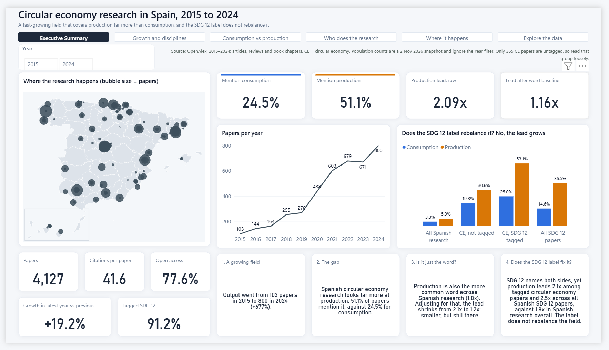
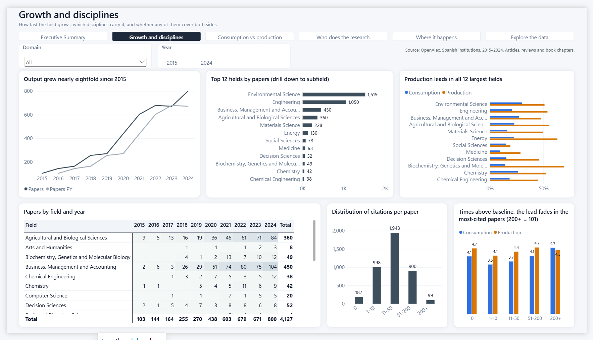
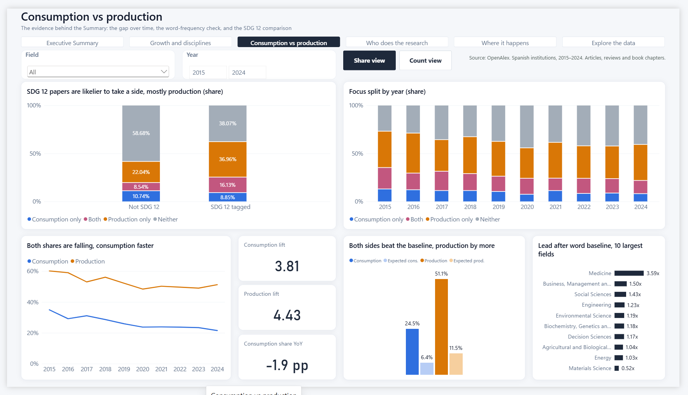
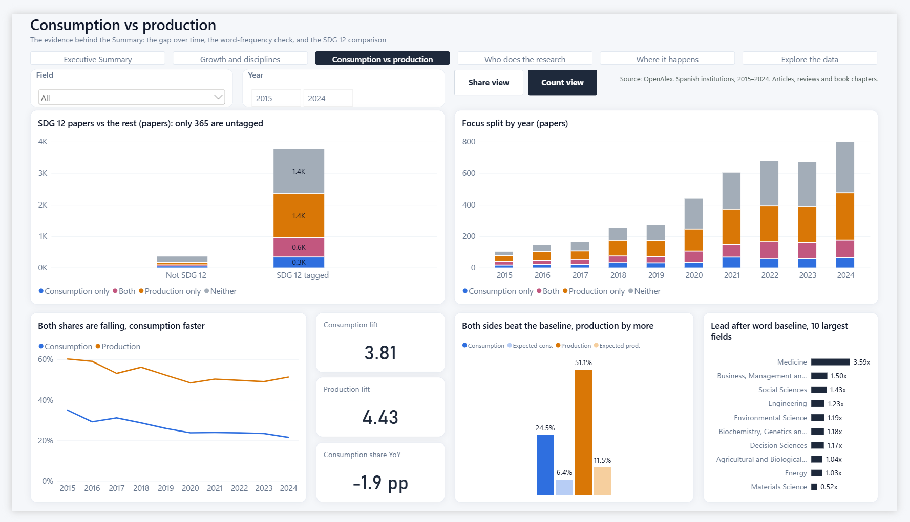
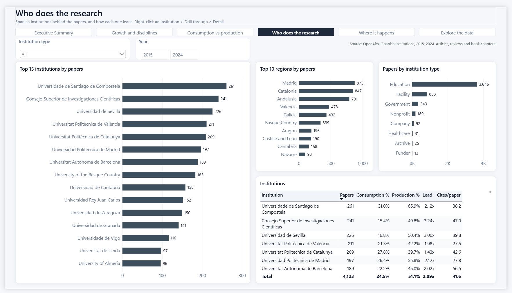
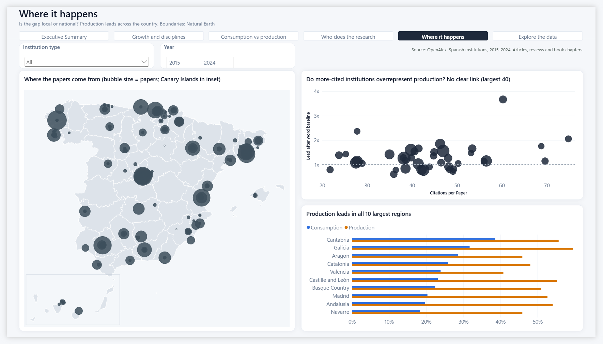
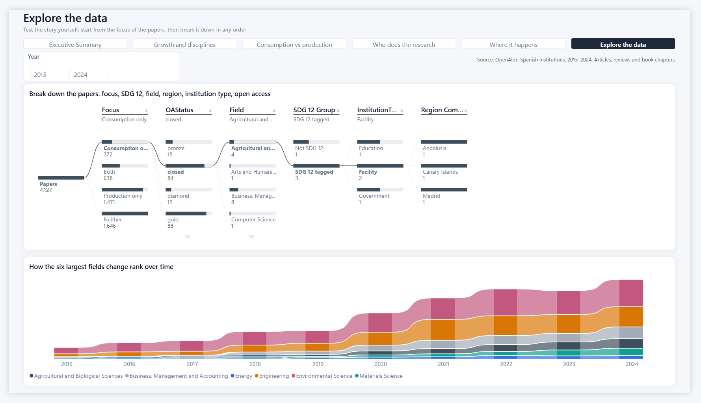
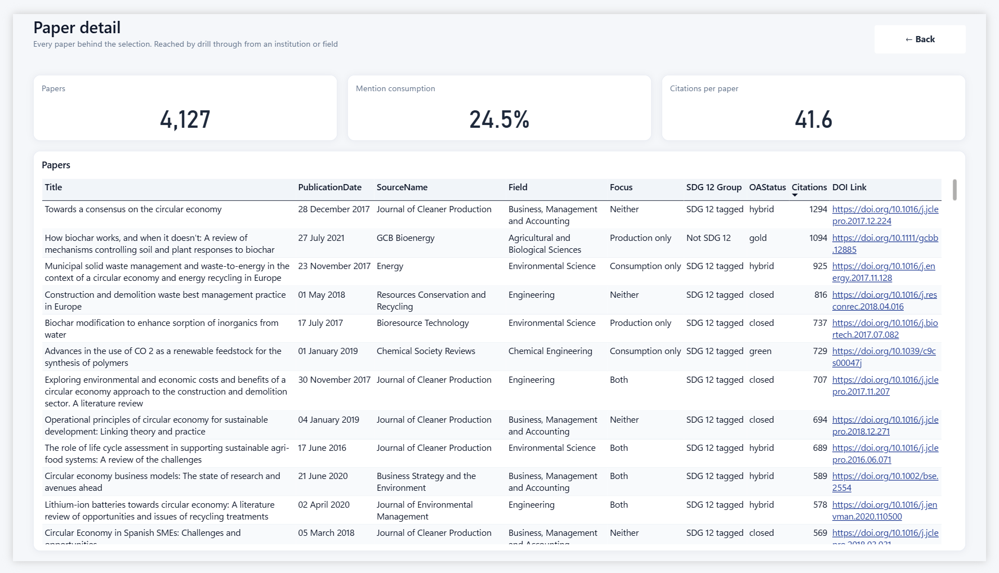
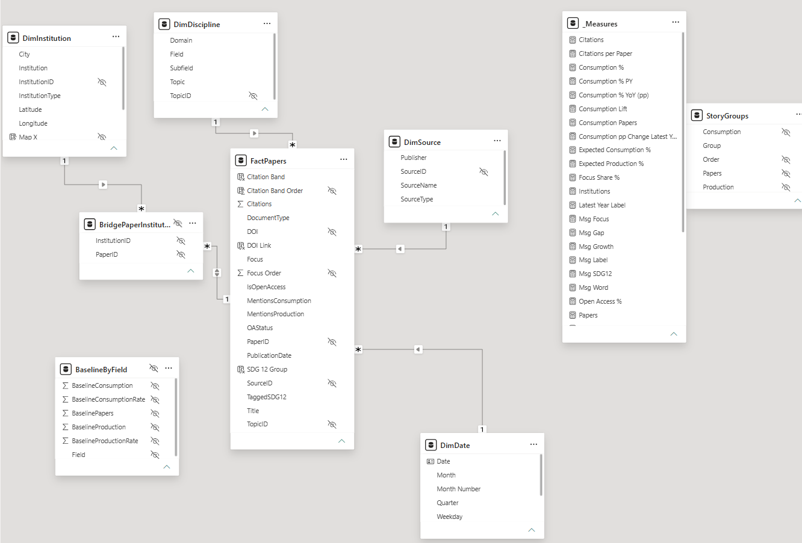

# Circular economy research in Spain: consumption or production?

A Power BI dashboard on circular economy (CE) research from Spanish institutions, built on open data from [OpenAlex](https://openalex.org).

**The question:** CE research in Spain is growing, but does it look at the consumption side or mostly at production? And does research tagged with SDG 12 (Responsible Consumption *and* Production) cover both?

## Main finding

Spanish CE research mentions production about twice as often as consumption (51.1% vs 24.5% of papers). Part of that is because "production" is the more common word across all Spanish research. After adjusting for this within each field, the production lead shrinks from 2.09x to 1.17x. It is smaller, but it remains.

The SDG 12 label does not rebalance the two sides. CE papers tagged with SDG 12 show a *larger* production lead (2.12x) than untagged CE papers (1.60x).

This is an association, not a cause. Mentions come from a word search on titles and abstracts, so "production" and "consumption" can also appear in other senses, such as energy production.

## Report pages

| Page | What it shows |
|---|---|
| Executive Summary | Headline numbers and the consumption/production split |
| Growth and disciplines | Papers over time and by field, citation bands |
| Consumption vs production | The central question, with the SDG 12 comparison and the field-adjusted baseline |
| Who does the research | Top institutions and institution types |
| Where it happens | Map of institutions and papers by region |
| Explore the data | A decomposition tree (focus, SDG 12, field, region, institution type, open access) and how the six largest fields change rank over time |
| Detail | Drill-through list of papers, with DOI links |

### Screenshots

**Executive Summary**


**Growth and disciplines**


**Consumption vs production** (the *Share view* and *Count view* buttons are bookmarks)



**Who does the research** (right-click an institution › Drill through › Detail)


**Where it happens**


**Explore the data**


**Detail** (drill-through target)


## Data

- **Source:** the OpenAlex API (`works` and `institutions` endpoints, plus group-by counts for the baseline).
- **Scope:** works with at least one Spanish institution, published 2015–2024. Only articles, reviews and book chapters are included.
- **Topic search** (titles and abstracts): "circular economy", "industrial ecology", "industrial symbiosis", "life cycle assessment" or "material flow analysis".
- **Whole-population comparison rows** (all Spanish research and all Spanish SDG 12 papers, in the `StoryGroups` table) are a fixed snapshot from 2 November 2026. They don't change on refresh.
- **SDG tags** come from OpenAlex's classifier, which keeps goals scoring above 0.4 ([how OpenAlex classifies SDGs](https://help.openalex.org/hc/en-us/articles/27972124390679-How-do-you-classify-works-as-contributing-to-the-UN-SDGs)).
- **Region field:** OpenAlex leaves Region blank for about half of the Spanish institutions. The calculated column `DimInstitution[Region Complete]` fills it from each institution's coordinates, tested against Natural Earth regional boundaries. Validated on the 197 institutions that already had a region, the method reproduced all of them. A city that first appears after a refresh shows as "Not mapped" until it is added to that column.

## Model

The model is a star schema around `FactPapers` (one row per paper), with `DimDate`, `DimDiscipline` (Domain > Field > Subfield > Topic), `DimSource` and `DimInstitution`. Papers often have several Spanish institutions, so `BridgePaperInstitution` links papers to institutions with a two-way filter. This lets an institution selection filter papers without counting any paper twice. `BaselineByField` holds the word rates across all Spanish research per field, used for the adjusted comparison.



## How to open it

### Just looking: use the `.pbix`

Download the `.pbix` from the [latest release](../../releases/latest) and open it in [Power BI Desktop](https://www.microsoft.com/power-platform/products/power-bi/desktop), which is free and Windows only. The data is included, so you don't need an account or a key.

### Refreshing or changing it: use the project

This repo holds the report as a Power BI Project (`.pbip`), saved as readable text files. It doesn't include the loaded data, so the report opens empty until you refresh it, and refreshing needs a free OpenAlex API key. Without a key, OpenAlex gives only a small shared daily allowance, and a full refresh runs out of it partway through.

1. Create a free OpenAlex account and get an API key at <https://openalex.org/settings/api>.
2. Open `GeorgantzisGarcia_Dimitris_circularEconResearch_Spain_project/GeorgantzisGarcia_Dimitris_circularEconResearch_Spain.pbip` in Power BI Desktop.
3. Go to **File › Options and settings › Data source settings**, select `https://api.openalex.org` and click **Edit Permissions**.
   - **Credentials:** click Edit, choose **Web API** and paste your key.
   - **Privacy level:** choose **Public**.
4. Click **Home › Refresh**. The first load pages through several thousand records, so it takes a few minutes.

Your key is stored only in your own Power BI settings on your PC. It is never written into the project files or a saved `.pbix`. The queries pass it to OpenAlex through `Web.Contents(..., [ApiKeyName = "api_key"])`.

## Repository layout

```
GeorgantzisGarcia_Dimitris_circularEconResearch_Spain_project/
├── ...circularEconResearch_Spain.pbip     open this in Power BI Desktop
├── ...circularEconResearch_Spain.Report/  pages, visuals, theme, map image
└── ...circularEconResearch_Spain.SemanticModel/
    └── definition/
        ├── expressions.tmdl    Power Query helpers (OpenAlex paging function, search terms)
        ├── tables/*.tmdl       tables, their queries and the DAX measures
        └── relationships.tmdl
queries/*.pq        every Power Query query, one file each (copy of what the project uses)
measures.dax        calendar table, calculated columns and all measures (copy of what the project uses)
theme.json          the report theme
docs/
├── index.html      explanatory document (served by GitHub Pages; source of the PDF)
└── screenshots/    one image per page, plus the model view
```

`queries/`, `measures.dax` and `theme.json` are readable copies for reference. The `.pbip` project is the source of truth.

## Credits

- Data: [OpenAlex](https://openalex.org) (CC0).
- Regional boundaries for completing the Region field: [Natural Earth](https://www.naturalearthdata.com) (public domain).

Author: Dimitris Georgantzis Garcia
